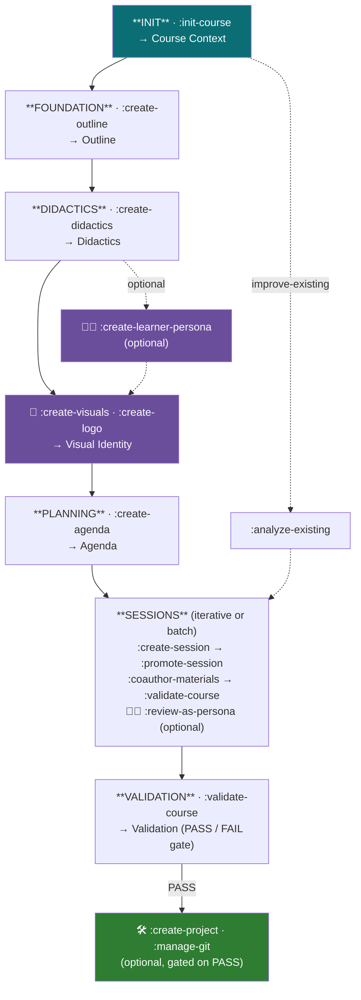

# Teaching-Agent 🎓

> A BMad-Method-powered, multi-agent AI assistant for structured course development with [LiaScript](https://liascript.github.io)

**Teaching-Agent** helps educators design, structure, and author complete courses through guided, iterative workflows — from initial concept to published, interactive materials. It coordinates four specialized agents (teaching, visual design, learner review, and publishing) around a single project file, `journal.md`, that holds the entire course state.

It is **editor-agnostic**: the same specs build into configurations for Claude Code, GitHub Copilot, OpenAI Codex, Cursor, Windsurf, and any web chat.

---

## Purpose & Audience of This Repository

> **Read this before the technical details below.** This repository is a worked example: it shows the LiaScript toolchain in practice, using a NIS2 compliance course as the concrete case.

The repository has **two layers**:

1. **A sample course — "NIS2 Ready."** A complete, self-paced course (six units) on the EU NIS2 Directive that works as a real training resource on its own. NIS2 was chosen as a fitting example because it concerns public administration and critical infrastructure, so the subject matter is directly relevant to the sectors LiaScript courses are often written for.
2. **The tooling behind it.** A separate LiaScript document — [`about-liascript.md`](./about-liascript.md) ("Behind the Scenes") — walks through the tools used to build the course — **LiaScript** itself, the **Teaching-Agent** multi-agent system, and the **`liaex` exporter** — and refers to concrete features in the course as examples. Written from scratch for readers new to all three, it documents *how* an interactive, accessible, standards-based Open Educational Resource is produced.

In short: the course is the example, and the tooling document explains how it was made — with open, standards-based, vendor-independent tools.

### Who the course material is for

Taken verbatim from the course definition (`journal.md` → `## Outline` → *Target Audience*):

> Employees across ministries, public administrations, and critical-infrastructure organizations (energy, health, digital infrastructure, transport, etc.) that fall under the EU NIS2 Directive — a mixed audience of decision-makers, IT/security staff, and general employees, with no deep technical or legal background assumed.

Accordingly, the material is written at a **beginner** level: every legal or technical term is paraphrased in plain language before it is named, and no prior technical or legal background is assumed.

> [!NOTE]
> The rest of this README describes the **generic Teaching-Agent tooling** that produced the course. For the current state and contents of the NIS2 course itself, see [`journal.md`](./journal.md). For a gentle, from-scratch tour of the tools — best opened in the [LiaScript viewer](https://liascript.github.io/) rather than read as raw text, since it is itself interactive — see [`about-liascript.md`](./about-liascript.md).

---

## Table of Contents

- [How It Works](#how-it-works)
- [The Four Agents](#the-four-agents)
- [`journal.md` — the Single Source of Truth](#journalmd--the-single-source-of-truth)
- [The Workflow](#the-workflow)
- [Installation](#installation)
- [Usage](#usage)
- [Live Dashboard with the LiaScript DevServer](#live-dashboard-with-the-liascript-devserver)
- [Optional LiaScript Skills](#optional-liascript-skills)
- [Commands Reference](#commands-reference)
- [Project Structure](#project-structure)
- [Example Session](#example-session)
- [License](#license)

---

## How It Works

Teaching-Agent follows **Spec-Driven Development**: you define *what* the course should achieve before writing any content.

1. **Define first, write later** — start with learning objectives, audience, and scope
2. **Design didactics deliberately** — choose teaching methods, style, and persona *before* materials
3. **Plan the structure** — build a complete agenda with clear per-session goals
4. **Create iteratively** — develop materials session-by-session, with validation gates at each step

The result is **consistency, traceability, and quality** across the whole course. This implements the **BMad Method** (Behavior-Model-Agnostic Design): defined personas, task-driven workflows, template-based outputs, and built-in validation.

**Learn more:**
- [BMad-Method Framework](https://github.com/bmad-code-org/BMAD-METHOD) — the core methodology
- [`specs/`](./specs/) — the complete technical specification (agents, tasks, templates, workflow)

---

## The Four Agents

The **Teaching-Agent** is the coordinator. It knows when to hand off to the other three via `:agent {name}`. Each agent has its own persona and command set, but they all read and write the same `journal.md`.

| Agent | Icon | Role | Activate with |
|-------|------|------|---------------|
| **Teaching** | 🎓 | Pedagogical structure & content (default) | active on start |
| **Artist** | 🎨 | Visual identity, logos, image prompts | `:agent artist` |
| **Learner** | 🧑‍🎓 | Persona-based, learner-perspective review | `:agent learner` |
| **Development** | 🛠️ | Git, publishing, GitHub Pages | `:agent development` |

The Teaching-Agent proactively suggests a handoff at the right moments — e.g. `:agent artist` after didactics are done, `:agent learner` after a session is validated, or `:agent development` once the course passes validation.

---

## `journal.md` — the Single Source of Truth

All planning, state, reviews, and notes live in **one file**: `journal.md`. It is itself a valid LiaScript document, so the project state is also a viewable course outline. Only final teaching materials (`materials/`), visual assets (`assets/`), and publishing files (`project.yaml`, `.github/workflows/`) stay separate.

`journal.md` is divided into fixed sections, each owned by a task:

| Section | Filled by | Contents |
|---------|-----------|----------|
| `## Dashboard` | `:update-dashboard` (auto) | Derived progress overview |
| `## Course Context` | `:init-course` | Course type, terminology, conventions |
| `## Outline` | `:create-outline` | Title, audience, learning objectives |
| `## Didactics` | `:create-didactics` | Teaching concept, persona, difficulty |
| `## Visual Identity` | `:create-visuals` | Colors, logo & image style |
| `## Templates` | `:manage-templates` | LiaScript template imports & usage |
| `## Agenda` | `:create-agenda` | Session structure |
| `## Sessions` | `:create-session` … | Per-session skeletons, validation & persona reviews |
| `## Agents` | `:configure-agent`, `:create-learner-persona` | Agent customizations, learner personas |
| `## Validation` | `:validate-course` | Latest validation summary (publishing gate) |
| `## Analysis Status` | `:analyze-existing` | Gap analysis for existing courses |
| `## Notes Backup` | `:save-notes`, `:save-decision` | Summaries, research, decision records |

---

## The Workflow



### Course types

`:init-course` first asks for a **course type**, which sets terminology, persona, pacing, and whether an agenda is required:

| Type | Terminology | Persona | Agenda |
|------|-------------|---------|--------|
| `lecture-series` | session / lecture | professor | required |
| `self-paced` | unit / module | coach | optional |
| `workshop` | block / activity | facilitator | required |
| `single-lesson` | lesson | tutor | optional |
| `improve-existing` | (from existing) | (from existing) | runs `:analyze-existing` |

### Two ways to build sessions

- **Iterative** — fully develop one session (create → promote → coauthor → validate → review), then move to the next. Focused.
- **Batch** — create all skeletons, then promote all, then coauthor all. Overview-first.

### Fast-track: `:scaffold`

If you already know what you want, `:scaffold` replaces `:init-course → :create-outline → :create-didactics → :create-agenda → :create-session` with a **single intake interview** followed by automatic generation of the whole structure. Co-authoring stays interactive afterward.

### Publishing gate

Publishing (`:create-project`, `:update-project`) is **blocked until** `:validate-course` records `Mode: course` + `Result: PASS` in `## Validation`. This keeps half-finished courses from being shipped.

---

## Installation

### 1. Get the project

```bash
git clone <your-repo-url> teaching-agent
cd teaching-agent
```

### 2. Build the agent configuration for your editor

The source of truth lives in `specs/`. The build script renders it into the right format for each environment:

```bash
# Requires Python 3 (+ PyYAML for the navigation targets)
pip install pyyaml

python specs/build.py            # build all targets
python specs/build.py claude     # only Claude Code  → CLAUDE.md
python specs/build.py copilot    # only Copilot      → .github/copilot-instructions.md
python specs/build.py nav        # all "navigation" editors (claude, codex, cursor, windsurf)
python specs/build.py bundle     # all "bundle" targets (copilot, web)
```

| Target | Output file | Environment |
|--------|-------------|-------------|
| `claude` | `CLAUDE.md` | Claude Code CLI |
| `copilot` | `.github/copilot-instructions.md` | GitHub Copilot (VS Code / Web) |
| `codex` | `.codex/AGENTS.md` | OpenAI Codex CLI |
| `cursor` | `.cursor/rules/agent.md` | Cursor IDE |
| `windsurf` | `.windsurfrules` | Windsurf IDE |
| `web` | `dist/web-bundle.md` | Web chat (paste manually) |

There are **two build modes**:

- **Navigation** (`claude`, `codex`, `cursor`, `windsurf`): a lightweight pointer file. The agent reads each task file from `specs/` on demand — keeps context small.
- **Bundle** (`copilot`, `web`): one self-contained Markdown with all specs inlined, for environments without filesystem access. Paste `dist/web-bundle.md` into any chat.

> The generated files are committed, so for the supported editors you can often skip the build and just open the project.

---

## Usage

### Claude Code

Open the project — `CLAUDE.md` is picked up automatically. Then issue commands directly:

```
:help
:init-course
```

### GitHub Copilot (VS Code)

`.github/copilot-instructions.md` is loaded automatically. In Copilot Chat:

```
:help
:scaffold
```

### Cursor / Windsurf / Codex

Open the project; the respective rules file (`.cursor/rules/agent.md`, `.windsurfrules`, `.codex/AGENTS.md`) is read at startup. Issue the same `:` commands.

### Web chat (Claude.ai, ChatGPT, …)

Paste the contents of `dist/web-bundle.md` as the first message, then start with `:help`.

In every environment the agent introduces itself, reads `journal.md` if it exists, and tells you which step comes next.

---

## Live Dashboard with the LiaScript DevServer

`journal.md` can be opened as a live control panel. The
[LiaScript DevServer](https://github.com/LiaScript/LiaScript-DevServer) shows it in the
browser with a chat on top, and every action link in it talks to your agent:

```markdown
[▶️ Build session 3](agent:teaching/build-session?number=3) `:build-session 3` — material missing
```

A click sends `agent:<agent>/<command>?<parameters>` to the running agent — `teaching`,
`artist`, `learner` or `development`, and one of that agent's commands. The agent checks the
command, asks for missing details in the chat, confirms steps that change the project, runs
the task, and answers in the chat with the next steps as links. When `journal.md` changes,
the preview reloads. Without the DevServer the same lines simply show the command to type.

The chat shows which agent you are talking to (🎓 Teaching, 🎨 Artist, 🧑‍🎓 Learner,
🛠️ Development). Switch with its menu or a link like `[🎨 Artist](agent:artist/switch)`;
what you type goes to the agent shown there.

Links appear in the Dashboard (the one recommended next step, further options, open points)
and as one action line below each section heading. The Dashboard is a JSON data block that
the local LiaScript library [`specs/dashboard/`](specs/dashboard/README.md) renders via
`@Dashboard.View`; it and the action lines are written by `:update-dashboard`, the link format
is defined in [`specs/data/journal-links.md`](specs/data/journal-links.md), the handling of clicks and
the chat rules in [`specs/data/agent-links.md`](specs/data/agent-links.md) and its topic sheets. The agent writes the
data block only through `node specs/dashboard/write-dashboard.mjs <draft.json>` (checks the
draft, replaces the block in one write, then validates); `node specs/dashboard/validate-journal.mjs`
checks it on its own, including every `#` link against the real LiaScript heading anchors and
raw placeholders in visible commands.

To try a unit the way learners see it, `:try-as-learner {number}` opens the learner view of
the preview with a learning companion (a historical teacher via `find_teacher`, or the course's
guiding figure); it exists only in the preview, learners get no chat with published material.

**Checks for the specs themselves:** `node --test specs/check-specs.mjs` guards the key rules
found in the tandem tests against regressions (and scenario data leaking into the specs);
`node specs/dashboard/check.mjs` tests the Dashboard library.

**Setup**

1. Install the DevServer: `npm install -g @liascript/devserver`
2. Copy [`specs/templates/mcp.json`](specs/templates/mcp.json) to `.mcp.json` in the project
   root (`:init-course` and `:scaffold` offer to do it). The agent then starts
   `liadev --mcp --live -i journal.md` by itself.
3. Start your agent:
   - **Claude Code** — clicks arrive immediately through
     [channels](https://code.claude.com/docs/en/channels):
     `claude --dangerously-load-development-channels server:liascript`
   - **Codex, Gemini CLI, …** — register the same server in their MCP configuration
     (Codex: raise `tool_timeout_sec`, a confirmation waits for your click). They receive
     clicks through the `wait_for_event` tool.
4. `:preview` opens `journal.md` in the browser; `:preview materials/03-…/README.md` shows a
   session's material.

What happens in the browser ends up as a prompt for your agent. The agent therefore only runs
commands from its own command list, confirms every change in the chat, and asks in the
terminal before anything touches git or publishing.

---

## Optional LiaScript Skills

The agents use the [LiaScript skills](https://github.com/LiaScript/skills) when they are
installed — in the project (`.claude/skills/`, `.agents/skills/`, …) or for your user
(`~/.claude/skills/`, `~/.agents/skills/`, …). They work without them, too; if a missing
skill clearly helps the current step, they ask once per conversation and install it into
the project only after your consent in the terminal (never globally).

| Skill | Used by | Where |
|---|---|---|
| `liascript-syntax` | 🎓 Teaching | writing, fixing and validating materials |
| `reference-checker` | 🎓 Teaching | checking a session's references during validation |
| `liascript-templates` | 🎓 Teaching | building your own template in `:manage-templates` |
| `creativity` | 🎓 Teaching | optional open ideation in `:create-outline` and `:scaffold` |
| `liascript-theming` | 🎨 Artist | a LiaScript theme from the visual identity in `:create-visuals` |
| `liascript-exporter` | 🛠️ Development | `project.yaml`, GitHub Actions, exports |
| `oersi-metadata` | 🛠️ Development | `metadata.yml` to list the course on OERSI |

You can also install them yourself, e.g. `npx -y skills add LiaScript/skills --skill liascript-syntax`.
Details: [`specs/data/skills.md`](specs/data/skills.md).

---

## Commands Reference

### Teaching-Agent 🎓

| Command | Purpose |
|---------|---------|
| `:init-course` | Initialize project; choose course type; create Course Context |
| `:scaffold {course-type?}` | Fast-track: one interview → full structure |
| `:analyze-existing` | Scan an existing course and fill gaps (`improve-existing`) |
| `:create-outline` | Title, audience, 3–5 learning objectives |
| `:create-didactics` | Teaching concept, instructor persona, difficulty |
| `:create-learner-persona {name?}` | Build an evidence-based learner persona |
| `:create-agenda` | Structure sessions / modules |
| `:manage-templates {name?}` | Add & document LiaScript template imports |
| `:update-dashboard` | Regenerate the derived `## Dashboard` and the action links in `journal.md` |
| `:preview {file?} {slide?}` | Show `journal.md` or a material file in the LiaScript DevServer preview |
| `:create-session {n} {title?}` | Create a session skeleton |
| `:promote-session {n}` | Expand skeleton into a material document (`materials/{n}-{slug}/README.md` in multi-file mode, or a `##` chapter in root `README.md` in single-file mode — see `specs/data/file-structure-modes.md`) |
| `:coauthor-materials` | Interactive content co-authoring in persona |
| `:quick-fix {n} {description}` | Targeted single-issue correction |
| `:validate-course [{n}]` | Full course check, or single-session check |
| `:save-notes {type?} {title?}` | Save a summary / research / decision note |
| `:save-decision {title}` | Save a structured decision record (ADR) |
| `:configure-agent {agent}` | Customize an agent's behavior in `journal.md` |
| `:agent {character}` · `:list-agents` | Switch persona · list available agents |
| `:help` · `:exit` | Show actions · leave persona |

### Artist-Agent 🎨

| Command | Purpose |
|---------|---------|
| `:create-visuals` | Define colors, logo & image style → Visual Identity |
| `:create-logo` | Generate a detailed logo prompt |
| `:create-image {description}` | Create an image prompt on demand |

### Learner-Agent 🧑‍🎓

| Command | Purpose |
|---------|---------|
| `:review-as-persona {name} {n}` | Review a material as a specific learner persona |
| `:list-learners` | List defined learner personas |

### Development-Agent 🛠️

| Command | Purpose |
|---------|---------|
| `:manage-git` | Stage, commit, push, diff, resolve conflicts |
| `:create-project` | Multi-file: generate `project.yaml` + GitHub Pages workflow. Single-file: push to GitHub, hand back the LiaScript viewer link (no project.yaml/Pages) |
| `:update-project` | Multi-file: update publishing config & redeploy. Single-file: push the update (viewer link stays the same) |

---

## Project Structure

```
specs/
  main.md              ← web-bundle header
  build.py             ← config generator (run this to (re)build)
  project.yaml         ← example LiaScript publishing config
  agents/              ← agent personas (teaching, artist, learner, development)
  tasks/               ← one task definition per command
  templates/           ← YAML templates for journal.md sections
  checklists/          ← quality checks (used by :validate-course)
  data/                ← LiaScript cheat-sheet & workflow reference
  workflows/           ← course-development.yaml (the master workflow)

journal.md             ← project state (single source of truth)
materials/             ← generated LiaScript course materials (multi-file mode only)
assets/                ← generated visual assets & prompts (single-file mode; nested per session under materials/ in multi-file mode)

CLAUDE.md              ← generated: Claude Code config
.github/copilot-instructions.md  ← generated: Copilot config
.codex/AGENTS.md       ← generated: Codex config
.cursor/rules/agent.md ← generated: Cursor config
.windsurfrules         ← generated: Windsurf config
dist/web-bundle.md     ← generated: paste-anywhere bundle
```

---

## Example Session

```
:init-course
   → Choose "lecture-series", title "Databases Unlocked",
     audience "CS undergraduates (3rd–5th semester)", language de, Sie-form

:create-outline
   → 5 learning objectives, abstract on database paradigms

:create-didactics
   → Persona: "practical professor, hands-on, browser-based examples"

:agent artist → :create-visuals
   → Teal/orange palette, consistent course image style

:agent teaching → :create-agenda
   → Blocks: file formats → key-value → document → relational SQL

:create-session 1 lecture "Data & Serialization"
:promote-session 1 lecture
:coauthor-materials
   → Add interactive DuckDB-Wasm examples and a quiz

:validate-course 1 lecture
:agent learner → :review-as-persona alex 1 lecture
   → Check cognitive load and assumed prior knowledge

:agent teaching → :validate-course        # full course → PASS
:agent development → :create-project       # publish to GitHub Pages
```

---

## License

[Boost Software License 1.0](./LICENSE) — a permissive license allowing free use, modification, and distribution.

---

**Ready to build your course?** Start with:

```
:help
```
