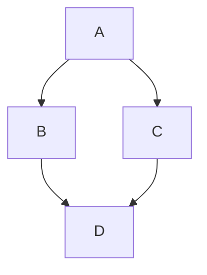

# LiaScript Guide – Syntax, Semantics & Best Practices

## Purpose

A compact reference guide for agents to produce **syntactically and semantically correct LiaScript**.

---

## 1) Course Metadata (Header)

```lia
<!--
author:   Firstname Lastname
email:    user@example.org
version:  1.0.0
language: en
narrator: English Female
comment:  Short description of the course
-->
```

**Notes**

- `language` and `narrator` define TTS/voice output.
- `comment` may be used as an abstract or summary.

---

## 2) Structure: Headings & Sections

```lia
# Main Title (Course Title Page)
## Section
### Subsection
```

**Rules**

- Only one `#` heading per file (the course title).
- Use hierarchical structure logically; avoid “jumps” in heading levels.

---

### Additional Rule: Subheadings within a Slide

- Each `#`, `##` and `###` heading **always starts a new slide** — the heading depth is the slide hierarchy (a `###` is a sub-slide of the `##` above it).

- Use bare `###` only where a new (sub-)slide is wanted, e.g. the parts of a unit in single-file mode (`templates/session-material.yaml` → `heading_levels`).

- Subheadings from `####` down to `######` are only allowed if **embedded** inside:

  - an **HTML block** (`<div>…</div>` or a semantic wrapper such as `<section>…</section>`)
  - a **list** (`-`, `*`)
  - a **blockquote** (`>`)

- A “naked” `####`-or-deeper subheading outside such containers counts as a new slide/segment and is therefore **not allowed**.

**Allowed patterns:**

```lia
## Slide 1

### Bare subsection directly under the slide — no container needed

<div>
#### One level deeper — must be embedded
</div>
```

```lia
## Slide 2

### Bare subsection — fine on its own

<section>
#### Subsection embedded in a semantic <section> wrapper
</section>
```

```lia
## Slide 3

- List with content
  - #### Subheading inside a list
```

```lia
## Slide 4

> #### Subheading in a blockquote
```

**Not allowed (`####`-or-deeper outside of containers):**

```lia
## Slide 5

### Bare subsection — fine
#### Subheading without container   ❌
```

---

## 3) Text, Lists, Quotes, Alerts & Citations

```lia
Normal text with **bold** and *italic*.

- List item 1
- List item 2

> Quote / Key takeaway
```

**Tip:** Use short paragraphs and learner-friendly phrasing.

---

### Alerts

LiaScript supports GitHub/GitLab-style alert blocks. Alerts are written as blockquotes whose first line contains an alert marker.

```lia
> [!NOTE]
> Useful background information or a neutral hint.

> [!TIP]
> Practical advice or a helpful shortcut.

> [!IMPORTANT]
> Information that learners must not miss.

> [!WARNING]
> A warning about possible mistakes or risks.

> [!CAUTION]
> Strong caution about negative consequences.
```

**Supported alert types:**

- `NOTE`
- `TIP`
- `IMPORTANT`
- `WARNING`
- `CAUTION`

**Custom titles are allowed** by adding text after the alert type:

```lia
> [!NOTE] Keep this in mind
> This alert uses a custom title.
```

An emoji or icon in the custom title can be used to visually override or emphasize the default alert icon:

```lia
> [!WARNING] ⚠️ Proceed with caution
> This action cannot be undone.
```

**Best practices**

- Use alerts sparingly.
- Prefer `NOTE` for neutral explanations.
- Use `TIP` for practical advice.
- Use `IMPORTANT`, `WARNING`, and `CAUTION` only when the distinction matters.
- Alerts are blockquotes, so every line of the alert should start with `>`.

---

### Citations

LiaScript citations are also written as blockquotes. A citation consists of a quote followed by a separate citation line starting with `--`.

```lia
> “Live as if you were to die tomorrow.
> Learn as if you were to live forever.”
>
> -- Mahatma Gandhi
```

The line beginning with `--` is interpreted as the citation/source line.

**Pattern:**

```lia
> Quoted or referenced text.
>
> -- Author, source, year, or reference
```

**Examples:**

```lia
> “The medium is the message.”
>
> -- Marshall McLuhan
```

```lia
> Historical sources should always be interpreted in their political,
> social, and cultural context.
>
> -- Course note, Source Analysis
```

**Best practices**

- Keep citations short and readable.
- Use the `--` line only for the source or attribution.
- Leave an empty blockquote line `>` between the quote and the citation.
- Do not use citations as a replacement for bibliographies or full references.
- For long sources, combine a short citation block with a separate reference list.

---

## 4) Presentation Mode & Speech Output

### Optimized Rules: Presentation Mode & Speech Output

1. **Slide Structure**

   - Every `##` heading creates a **new slide**.
   - After each new slide (`##`), the **animation/comment numbering** (`--{{n}}--`, `{{n}}`) resets to **0**.
   - Headings within `<div>…</div>`, lists, or blockquotes do **not** start new slides.

2. **Animations**

   - Each animation is controlled with `--{{n}}--` (comment/TTS) or `{{n}}` (visible content).
   - Numbering starts at 0 for each slide.
   - Ranges `{{a-b}}` mean: content appears at step `a` and disappears at step `b`.

3. **Speech Output (TTS)**

   - Each `--{{n}}--` block contains a **spoken comment** read aloud during the corresponding animation step.
   - Comments should sound like **explanatory sentences**, not bullet points.
   - **Optional:** `{{|>}}` creates a play button for manual playback (it shows a small play triangle ▶, no text — see section 10 → Controls as learners see them).
   - The voice is defined in the header (`narrator`) but can be overridden per section via comment:

     ```lia
     <!--
     narrator: English UK Female
     -->
     ```

4. **Style**

   - Structure each slide **like a PowerPoint slide**: clear title, short text, matching speaker comments.
   - Each animated block should have its **own** TTS comment.
   - Avoid long text blocks: maximum **one paragraph per animation**.

---

### Minimal Example (Optimized)

```lia
## Slide 5

    --{{0}}--
Introductory text read at slide start.

    --{{1}}--
This is read during the first animation step.

      {{1}}
> Quote appears at step 1.

    --{{2}}--
In the second step, a table is displayed.

      {{2-3}}
<div>
### Table inside HTML block (no slide switch)

| Column A | Column B |
|----------|----------|
| Value 1  | Value 2  |

</div>

    --{{3}}--
Closing comment. The next slide starts again at 0.
```

---

## 5) Media: Images, Audio, Video, oEmbed

Multimedia links can be included locally (relative paths) or externally (URLs).

```lia


?[Audio / Link text](assets/audio/intro.mp3 "Optional audio caption")

!?[Video / Link text](https://www.youtube.com/watch?v=dQw4w9WgXcQ "Optional video caption")

??[oEmbed / Link text](https://example.org/resource "Optional oEmbed caption")
```

**Encode link targets.** LiaScript ends a link or image target at the first
`(` — also balanced parentheses, which CommonMark allows — and a bare URL keeps
its full text but gets a cut-off address. In every link and image target
percent-encode `(` as `%28`, `)` as `%29` and spaces as `%20`, and write a bare
URL as `[label](encoded URL)`:

```lia

```

**Image size.** A style comment directly after the image (same line) sets its
display size; it also works inside quiz options. Images that are answer options
of one question get a height limit so the question and all options fit one
screen of the target device; a large page photo may get one too:

```lia
Which picture shows a ripe fruit?

- [( )] <!-- style="max-height: 30vh" -->
- [(X)] <!-- style="max-height: 30vh" -->

<!-- style="width: 30%" -->
```

Request a matching file size from the collection, too: Wikimedia Commons
serves only standard thumbnail widths (e.g. `?width=330` for answer options and
small pictures, `?width=500` for page photos); other widths are rounded up to a
much larger file or rejected.

A `vh` limit does not guarantee the fit: the page header, the introduction and
the question do not shrink with the window, and image-only options stand one
below the other. Whether a question fits is known only from a measurement at the
learners' window size (the check script's viewport report) or from a look at the
learners' device (`data/chat-checks.md` → Say how you checked).

**Accessibility (A11y)**

- Meaningful alt text and descriptive filenames.
- For external videos: provide a brief summary.

---

**Galleries** can be created by adding multiple media elements in sequence:

```lia

?[Audio / Link text](assets/audio/intro.mp3 "Optional audio caption")
!?[Video / Link text](https://www.youtube.com/watch?v=dQw4w9WgXcQ "Optional video caption")
??[oEmbed / Link text](https://example.org/resource "Optional oEmbed caption")
```

---


### Link targets

In every Markdown link or image target — chat, material,
  and journal fields such as `__File:__`, `__Page:__`, `__Candidates:__` —
  percent-encode `(` as `%28`, `)` as `%29` and spaces as `%20`; write a bare
  URL as `[label](encoded URL)`. LiaScript cuts a target at the first
  unencoded `(` (file names from photo collections often contain one), and the
  chat cannot replace a sent message with a broken image.

## 6) Diagrams

Diagrams can be created using Mermaid. The `@mermaid` tag ensures proper rendering.

````lia

````

Alternatively, diagrams can be created with ASCII art. The syntax info `ascii` ensures correct formatting.

````lia
```ascii  Optional subtitle
  +---+      +---+
  | A | *--> | B |
  +---+      +---+
    ^          ^
    |          |
    |   .------'
    v  /
  +---+
  | C |
  +---+
```
````

---

## 7) Formulas & Equations

Mathematical formulas use LaTeX syntax.

Inline formula: $E = mc^2$

A pair of `$` starts math everywhere outside code. Write spreadsheet references, prices or other text with `$` as inline code (`` `$C$7` ``), otherwise it is set as a formula.

Block formula as separate paragraph:

$$
\sum_{i=1}^{n} i = \frac{n(n+1)}{2}
$$

---

## 8) Code & Execution

````lia
```js
console.log("Hello LiaScript!");
```
````

**Note:** Use correct language tags (`js`, `py`, `html`, etc.).

For interactive code with input fields, attach a `<script>` block or macro directly after the code block:

````lia
```js
console.log("Hello LiaScript!");
```
<script>
@input
</script>
````

---

## 9) Tables

```lia
| Era      | Feature         | Example      |
|----------|-----------------|---------------|
| Antiquity| Aulos, Lyre     | Seikilos Song |
| Baroque  | Basso continuo  | J. S. Bach    |
```

---

## 10) Quizzes & Interaction

**Single Choice**

```lia
Who composed the 9th Symphony?

- [( )] Mozart
- [(X)] __Beethoven__
- [( )] Haydn
```

**Multiple Choice**

```lia
Select all Baroque composers.

- [[X]] Bach
- [[X]] Handel
- [[ ]] Debussy
```

**Matrix Quiz (graded, for matching tasks)**

```lia
Which article belongs to the word?

- [[der] [die] [das]]
- [ ( )  (X)  ( ) ]  Frau
- [ (X)  ( )  ( ) ]  Mann
- [ ( )  ( )  (X) ]  Kind
```

- The first line holds the column labels; each row starts with `(` (one answer per row) or `[` (several answers per row) and ends with the row label.
- This is a **quiz** with a solution. The matrix under Surveys (10b) looks similar but has no solution — never use it for a task with a right answer.

**Text Quiz**

```lia
Composer of the 9th:

[[Beethoven]]
```

**Open Question**

```lia
?[Briefly explain: Why was the Marseillaise politically significant?]
```

**Tips**

- One question = one learning goal.
- Optional feedback (explanation after the answer).

**Quizzes for young learners / self-checks**

Pick the pattern by the didactics. **Hint instead of solution** (no automatic solution): no `data-max-trials`.

```lia
Which one is right?

<!-- data-hint-button="1" data-solution-button="false" -->
- [( )] option A
- [(X)] option B
[[?]] a hint in plain words
```

**Solution after n tries** (the didactics allow it): `data-max-trials` plus a feedback line for the shown solution.

```lia
Which one is right?

<!-- data-hint-button="1" data-max-trials="2" data-solution-button="false" data-text-resolved="Here is the solution – look at it again." -->
- [( )] option A
- [(X)] option B
[[?]] a hint in plain words
```

- **The comment goes directly above the first answer line, not above the question.** An attribute comment belongs to the block that follows it; above the question it sets attributes on the question paragraph and the quiz ignores it. For a gap text it goes directly above the paragraph with the gaps.
- Hints are their own lines after the options (`[[?]] …` or `- [[?]] …`), not indented under an option.
- `data-hint-button="1"`: hint button after the 1st wrong try; `data-max-trials="2"`: the solution is shown automatically after the 2nd wrong try.
- `data-solution-button="false"` hides the "show solution" button. **Without it the button is visible from the start**, also when `data-max-trials` is set.
- Free-text tasks: always `data-solution-button="false"`.
- Read answer options aloud with inline playback on the option (`{|>}{option text}`) instead of repeating them in the question text. Hint texts the same way where the target group needs read-aloud: `- [[?]] {|>}{Hint text}` — the play button appears when the hint is shown.
- Every option has its own text (two equal options make the quiz unsolvable); an option that waits for an image carries a neutral word ("picture 1"), never the answer.
- **No surface cues:** only understanding may find the answer. Options of one question are about equally long (the correct one never clearly the longest), built the same way (same subject, same grammatical form, the same first word where the others share one), and the correct one changes its position from question to question. Gap cards carry no article, case ending or capital letter that tells their gap — the article stays in the sentence. A sentence with gaps is not also written out as its own line on the page. `check-material.mjs` reports what it can measure ("Answer patterns").
- No table or matrix quiz wider than 3 short columns; on narrow screens prefer several single-choice questions.
- Feedback lines can be changed per quiz (since LiaScript 2.0): `data-text-solved`, `data-text-failed`, `data-text-resolved` — inline Markdown or a single emoji; an empty value hides the line. For the whole course, define them once as header macros (`@ok: ⭐ Super!`) and use `data-text-solved="@ok"`. Surveys have no such attributes.

**Controls as learners see them**

| Control | What the page shows |
|---|---|
| read aloud (block or inline) | a small play triangle ▶ (⏸ while playing) without text — in a small box before a block, in a circle before an inline text or option |
| hint (`[[?]]`) | a light bulb without text, after the first wrong check |
| check | a button with the player's word for "check" (translated by the player), followed by the number of checks |
| solution | hidden with `data-solution-button="false"` |

- Learner texts, plans and the companion name a control by what the page shows, or show the symbol itself ("tap ▶", translated) — never "speaker", "loudspeaker" or another icon the page does not have. The tooltips are not visible on touch screens.
- A hint appears only when the learner taps the light bulb: say so in plans and texts ("after a wrong try the light bulb gives a hint", translated) — never "a hint comes after the first mistake".

---

## 10b) Surveys – Feedback without Solutions

Surveys are like quizzes but **without a correct answer** — you provide a placeholder or options instead of a solution. State is stored if the course version is ≥ 1.0.0.

### Text Input

Single-line (comma-separated input):

```lia
[[___]]
```

Multi-line textarea — the **number of `___` groups** defines the number of lines:

```lia
[[___ ___ ___]]
```

---

### Single-Choice Vector

Uses **numbers or labels** in parentheses. Numbers → distribution plot in classroom; text labels → categorical chart.

```lia
How do you rate this session?

[(1)] Excellent
[(2)] Good
[(3)] Neutral
[(4)] Poor
```

Or with text labels:

```lia
[(very good)]  I like it very much
[(good)]       It is ok
[(bad)]        I don't like it
```

---

### Multi-Choice Vector

Uses **labels** in double square brackets. Labels only → categorical; start with numbers → continuous.

```lia
Which topics were useful?

[[theory]]    Theory part
[[examples]]  Code examples
[[exercises]] Exercises
```

With numbers (continuous scale):

```lia
[[1 theory]]    Theory part
[[2 examples]]  Code examples
[[3 exercises]] Exercises
```

---

### Single-Choice Matrix

Define a **header row** of options in parentheses, then one row per question with empty brackets:

```lia
[(strongly agree)(agree)(neutral)(disagree)(strongly disagree)]
[                                                             ] The pace was appropriate.
[                                                             ] The examples were helpful.
[                                                             ] I would recommend this course.
```

With numbered labels for distribution charts:

```lia
[(1 strongly agree)(2 agree)(3 neutral)(4 disagree)(5 strongly disagree)]
[                 ] The pace was appropriate.
[                 ] The examples were helpful.
```

---

### Multi-Choice Matrix

Same structure as single-choice matrix, but uses **double brackets** in header and body:

```lia
[[1][2][3][4][5]]
[             ] I understood the learning objectives.
[             ] I could apply the content right away.
[             ] I would like more exercises.
```

---

### Surveys and Scripting

Attach a `<script>` to validate or forward the input (same as quizzes):

```lia
Please describe your main takeaway:

[[___]]
<script>
  let input = `@input`.trim()
  if (input.length > 4) {
    true
  } else if (input.length == 0) {
    send.lia("Please enter some text.", [], false)
  } else {
    send.lia("Please provide a more detailed answer.", [], false)
  }
</script>
```

**`@input` values per type:**
- Text input → string
- Single-choice vector → number (index, -1 if nothing selected)
- Multi-choice vector → array of 0/1 values
- Single-choice matrix → array of numbers
- Multi-choice matrix → array of arrays

---

## 11) Including External Content

```lia
@import(./snippets/task.md)
@include(https://example.org/note.md)
```

- Use `@import` for local fragments, `@include` for external sources.

---

## 12) Variables & Simple Macros

```lia
<!--
@myvar: __Music History__
-->

# Title

Welcome to the @myvar course!
```

---

## 13) Example Task Pattern

```lia
## Task: Source Analysis (Marseillaise)

1. Read the text (excerpt linked).
2. Highlight political keywords.
3. Answer:

   Which theme dominates?

   - [(X)] Freedom
   - [( )] Romanticism
   - [( )] Commerce

> Reflection: 2–3 sentences on its impact on contemporaries.
```

**Learning goal:** Clearly state what the task aims to achieve.

---

## 14) Audio-Supported Sections

The animation pattern `{{|>}}` creates a play button. When clicked, the section below is read aloud via TTS.

```lia
    {{|>}}
This section will be read aloud when the play button is clicked.
```

**Note:** The `narrator` in the header defines the voice for speech output; without it LiaScript reads with a default English voice, whatever `language:` says. Embedded snippets (e.g. a chat message with `{{|>}}`) need their own header comment with `narrator:` and `language:`. The narrator can be overridden per section:

```lia
...

## Section 3
<!--
narrator: English UK Female
-->

    --{{1}}--
I will be read aloud in English during the first animation step.

    {{|> Russian Female 1-2}}
This section will be read in Russian when the play button is clicked, visible only between animation steps 1 and 2.
```

---

## 15) Accessibility (A11y) – Quick Checklist

- [ ] Alt text for all media
- [ ] Clear language, short sentences
- [ ] Maintain contrast/readability (for embedded HTML/CSS)
- [ ] Audio/video have short content summaries
- [ ] Logical navigation (heading hierarchy)

---

## 16) Common Mistakes & Pitfalls

- ❌ Unclosed code blocks (always open/close with three backticks)
- ❌ Wrong heading order (`###` without preceding `##`)
- ❌ Media without alt text
- ❌ Unencoded `(`, `)` or spaces in a link or image target (cuts the address, §5)
- ❌ Image answer options without a size limit (one option fills the screen, §5)
- ❌ Ambiguous or unclear quiz questions
- ❌ Overly long sections without structure

---

## 17) Mini Validation Before Export

- [ ] All code blocks properly closed
- [ ] Exactly **one** course title with `#`
- [ ] External links checked
- [ ] Quiz questions tested
- [ ] Course header metadata completed

---

## 18) Minimal Example (Structure)

````lia
<!--
author:   Erika Example
email:    erika@example.org
version:  1.0.0
language: en
narrator: English Female
-->

# Music & History – Introduction

## Antiquity

    --{{0}}--
Brief overview of antiquity.

    --{{1}}--
Which instruments existed in antiquity? Check the correct one.

      {{1}}
<div>
Instrument of antiquity?

- [(X)] Aulos
- [( )] Synthesizer
</div>

## Baroque

--{{0}}--
Run the following JavaScript example:

```js
console.log("Basso continuo = foundation");
```
<script>
@input
</script>
````